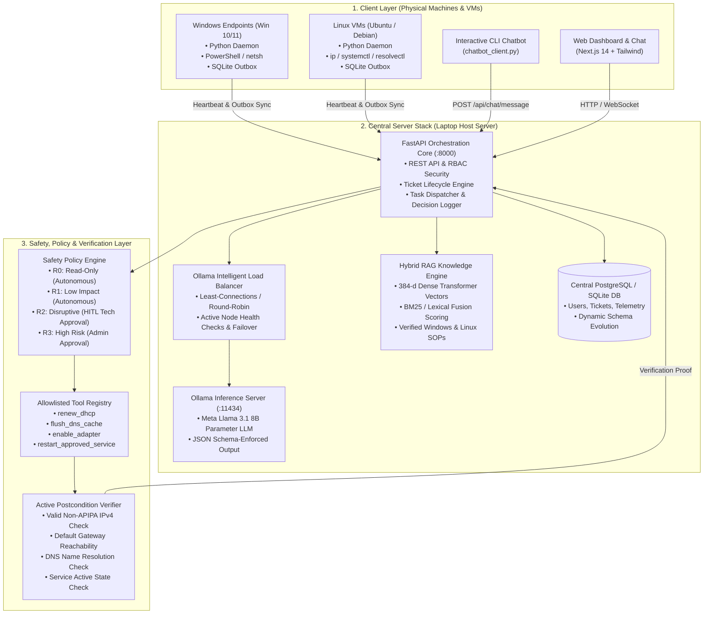
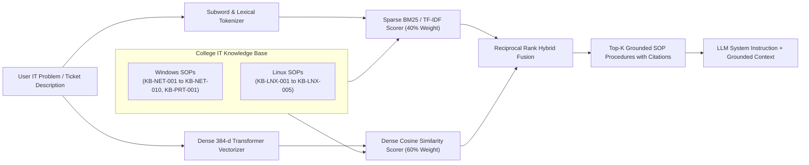
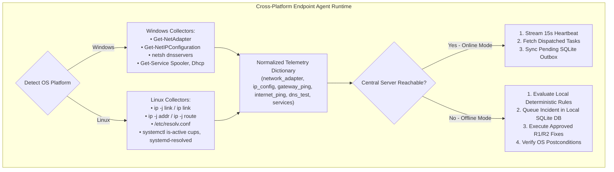
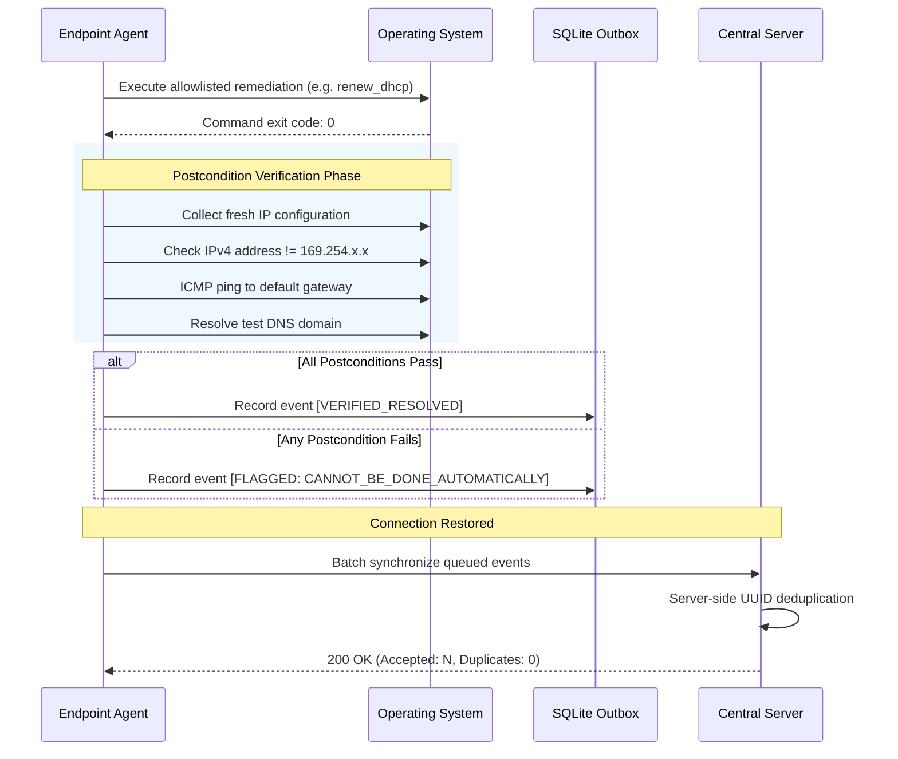

# AISD — Autonomous Intelligent Service Desk
### Hybrid Edge-Cloud IT Incident Management, Autonomous Diagnosis, Load-Balanced Local LLM & Cross-Platform Remediation System

[-success?style=for-the-badge&logo=pytest)](file:///e:/AISD/aisd/backend/tests)
[](file:///e:/AISD/aisd/endpoint-agent)
[](file:///e:/AISD/aisd/backend/app/services)
[](file:///e:/AISD/aisd/docs/ARCHITECTURE.md)
[](file:///e:/AISD/aisd/README.md)

---

## 📌 Table of Contents
1. [Executive Summary & Problem Statement](#-problem-statement)
2. [Why Choose This Problem Statement?](#-why-choose-this-problem-statement)
3. [System Architecture & Topology](#-system-architecture)
4. [Client-Server & Multi-Node Load Balancing](#-client-server--load-balancing-architecture)
5. [Hybrid RAG & Transformer Embeddings](#-hybrid-rag-engine--transformer-embeddings)
6. [Interactive IT Support Chatbot (Web & CLI)](#-interactive-it-support-chatbot)
7. [Cross-Platform Endpoint Agent (Windows + Linux)](#-cross-platform-endpoint-agent)
8. [Deterministic Rules & Safe Policy Engine (R0–R3)](#-deterministic-rules--safe-policy-engine)
9. [Postcondition Verification & Resilient Offline Outbox](#-postcondition-verification--offline-outbox)
10. [Repository Layout](#-repository-layout)
11. [Quick Start: Laptop Server & VM Clients](#-quick-start)
12. [Automated Verification & Test Suite](#-automated-verification--test-suite)

---

## 🎯 Problem Statement

Modern enterprise and university campus IT helpdesks face an acute operational crisis:
- **Excessive Ticket Volume & High MTTR (Mean Time to Resolution):** Between 60% and 75% of incoming helpdesk tickets represent recurring, trivial endpoint issues: APIPA `169.254.x.x` link-local addresses, stale DNS client caches, expired DHCP leases, accidental static IP misconfigurations, disabled network adapters, and halted background print daemons (`Spooler` on Windows or `cups` on Linux).
- **Diagnostic Latency & Information Asymmetry:** When an end-user submits a ticket ("*Internet is not working*"), IT technicians lack real-time observed telemetry. Back-and-forth communication takes hours or days merely to identify whether the physical cable is unplugged, gateway is unreachable, or DNS is timing out.
- **The Cloud AI Failure in Disconnected Scenarios:** Contemporary cloud-hosted AI IT chatbots (OpenAI GPT-4, Anthropic Claude, ServiceNow AI) suffer from a fatal flaw: **when an endpoint loses network connectivity, cloud AI becomes 100% inaccessible**. An endpoint disconnected from the internet cannot contact a cloud API to troubleshoot why it cannot access the internet!
- **Data Privacy & Telemetry Leakage:** Enterprises and academic institutions cannot transmit internal routing tables, subnet masks, active MAC addresses, domain names, and internal server IPs to third-party public clouds due to regulatory compliance, FERPA, GDPR, and security concerns.
- **Unverified "Fire-and-Forget" Scripts:** Conventional automation scripts execute a remediation command and blindly mark tickets as "Resolved" without validating whether the operating system actually transitioned to a healthy operational state.

---

## 💡 Why Choose This Problem Statement?

The Autonomous Intelligent Service Desk (AISD) was formulated to engineer a resilient, enterprise-grade solution to these fundamental IT challenges:

| Challenge in Traditional IT | How AISD Solves It |
|---|---|
| **Cloud Dependency during Outages** | **Local Ollama LLM + Offline Agent Autonomy:** AI runs locally on the on-premises laptop server (`llama3.1:8b`). If central connectivity is severed, endpoint agents switch autonomously to local deterministic diagnosis, execute approved R1/R2 fixes, and queue telemetry in a local SQLite outbox. |
| **Data Privacy & Compliance** | **100% On-Premises & Edge Computing:** All inference, embeddings, and telemetry logs remain strictly within the local host/subnet. Zero data leaves the institutional boundary. |
| **High Ticket Backlog for Common Issues** | **Autonomous Self-Healing:** Allowlisted tools (`renew_dhcp`, `flush_dns_cache`, `enable_adapter`, `restart_approved_service`) resolve the 10 most common network/OS failures in seconds with zero human intervention for R1 actions. |
| **Hallucination & Dangerous Shell Execution** | **Grounded RAG + Strict Tool Registry:** LLMs are strictly forbidden from generating arbitrary shell strings. Tool execution is constrained to a whitelist with schema validation and Human-in-the-Loop (HITL) technician approval for disruptive R2/R3 actions. |
| **Premature Ticket Resolution** | **Mandatory Postcondition Verification:** Tickets are **never** resolved merely because a process exited with code 0. AISD actively tests IP validity, gateway ICMP ping, and DNS resolution *after* remediation before certifying resolution. |
| **Heterogeneous Environments** | **Cross-Platform Parity:** Operates seamlessly across Windows 10/11 physical machines and Linux VMs (Ubuntu, Debian, CentOS, Fedora). |

---

## 🏛️ System Architecture

AISD utilizes a multi-tier, hybrid edge-cloud distributed architecture connecting a central AI server running on a laptop to client VMs and physical endpoints across the LAN.



---

## ⚖️ Client-Server & Load Balancing Architecture

To enable high-throughput AI inference across multiple lab computers and virtual machines, the laptop acts as the central server binding all interfaces:

```
               +-------------------------------------------------------------+
               |               LAPTOP (CENTRAL AI & REST SERVER)             |
               |                                                             |
               |   +-----------------------------------------------------+   |
               |   | Ollama Daemon (OLLAMA_HOST=0.0.0.0:11434, ORIGINS=*) |   |
               |   +--------------------------+--------------------------+   |
               |                              |                              |
               |   +--------------------------v--------------------------+   |
               |   | AISD Intelligent Load Balancer                      |   |
               |   | (Least Connections / Round-Robin / Auto-Failover)   |   |
               |   +--------------------------+--------------------------+   |
               |                              |                              |
               |   +--------------------------v--------------------------+   |
               |   | Central FastAPI Backend (:8000)                     |   |
               |   |  - Hybrid RAG (384-d Dense Transformers + BM25)     |   |
               |   |  - Central AI Chatbot Endpoint (/api/chat/message)  |   |
               |   |  - Load Balancer Telemetry & Health Monitoring      |   |
               |   +--------------------------+--------------------------+   |
               |                              |                              |
               |   +--------------------------v--------------------------+   |
               |   | Next.js Web Portal & Web Chatbot (:3000)            |   |
               |   +-----------------------------------------------------+   |
               +------------------------------+------------------------------+
                                              | (Bridged / NAT / Host-Only LAN)
                                              |
                  +---------------------------+---------------------------+
                  |                                                       |
+-----------------v-------------------------------+     +-----------------v-------------------------------+
|        LINUX VM CLIENT (Ubuntu/Debian)          |     |           WINDOWS VM CLIENT (Win 10/11)         |
|                                                 |     |                                                 |
|  * join_lan_agent.sh                            |     |  * JOIN_LAN_AGENT.bat                           |
|  * chatbot_client.py (Interactive Terminal)     |     |  * chatbot_client.py (Interactive Terminal)     |
|  * Linux Diagnostics (ip, systemctl, resolvectl)|     |  * Windows Diagnostics (netsh, PowerShell, WMI) |
|  * Linux Remediation (nmcli, cups, ufw)         |     |  * Windows Remediation (NetAdapter, Spooler)    |
|  * SQLite Offline Outbox + Auto Reconnect Sync  |     |  * SQLite Offline Outbox + Auto Reconnect Sync  |
+-------------------------------------------------+     +-------------------------------------------------+
```

### Key Load Balancer Capabilities:
- **Least-Connections Routing:** Requests are automatically dispatched to the Ollama node with the lowest active request count.
- **Latency & Failure Tracking:** Pings upstream `/api/tags` to monitor response latency and isolates unhealthy nodes.
- **Multi-Node Pool Expansion:** Additional Ollama worker nodes on the network can be dynamically registered via `POST /api/chat/loadbalancer/nodes`.
- **Live Health Metrics:** Accessible in real-time at `GET /api/chat/loadbalancer/status`.

---

## 🔍 Hybrid RAG Engine & Transformer Embeddings

AISD implements a **Hybrid Retrieval-Augmented Generation (RAG)** pipeline to eliminate AI hallucinations and ensure diagnostic recommendations are strictly grounded in institutional Standard Operating Procedures (SOPs):



### Supported Knowledge Base Procedures:
- `KB-NET-001`: College Wi-Fi & DHCP Lease Failure Recovery (APIPA 169.254.x.x)
- `KB-NET-002`: Default Gateway Unreachable on Subnet Guide
- `KB-NET-003`: Campus DNS Resolution Failure Remediation
- `KB-NET-004`: Network Adapter Disabled or Hardware Disconnected SOP
- `KB-NET-005`: Campus Wi-Fi Captive Portal Authentication
- `KB-PRT-001`: Windows Print Spooler Service Stoppage Recovery SOP
- `KB-NET-006`: Physical Media Disconnection / Wi-Fi Disconnected SOP
- `KB-NET-007`: Internet WAN Outage (Local LAN Functional) Guide
- `KB-NET-008`: Windows Defender Firewall Port & Profile Blocking SOP
- `KB-NET-009`: Multiple Active Network Adapters & Interface Conflict SOP
- `KB-NET-010`: High Latency & Packet Loss Remediation Guide
- `KB-LNX-001`: Linux NetworkManager & DHCP Interface Recovery SOP
- `KB-LNX-002`: Linux systemd-resolved DNS Cache Failure Remediation
- `KB-LNX-003`: Linux CUPS Printing Service Recovery SOP
- `KB-LNX-004`: Linux Default Gateway & Neighbor Table Flush SOP
- `KB-LNX-005`: Linux UFW & iptables Firewall Port Blocking SOP

---

## 💬 Interactive IT Support Chatbot

AISD provides two first-class chatbot interfaces for students, faculty, and IT technicians:

### 1. Interactive Terminal Chatbot CLI (`chatbot_client.py`)
Runs natively on both Windows and Linux terminals (in VMs or host systems):
- **Dynamic Online/Offline Switching:** Automatically detects server connectivity. When online, routes queries to the Central Server LLM + RAG. When disconnected, instantly falls back to local deterministic rule evaluation and offline SOPs.
- **Embedded Command Palette:**
  - `/diagnose`: Executes live local hardware and network diagnostics.
  - `/fix`: Triggers allowlisted remediation with postcondition verification.
  - `/status`: Displays host information, UUID, server connection, and outbox queue.
  - `/sync`: Manually flushes offline outbox events to the server.
  - `/help` & `/quit`: Contextual navigation.

### 2. Next.js Web Chatbot Interface (`/chat`)
Available via any web browser across the network:
- Real-time conversation thread with LLM-generated diagnostics.
- Badges displaying cited Standard Operating Procedures.
- Load Balancer live health pill showing upstream node status.
- 1-tap quick diagnostic prompt pills.

---

## 🐧 Cross-Platform Endpoint Agent

The endpoint agent runs with zero GPU footprint on both Windows and Linux workstations:



### Platform Feature Parity:
| Capability | Windows Implementation | Linux Implementation |
|---|---|---|
| **Interface Enumeration** | PowerShell `Get-NetAdapter` | `ip -j link` / `ip link` |
| **IP & Gateway Discovery** | `Get-NetIPConfiguration` / `ipconfig` | `ip -j addr` / `ip -j route show default` |
| **DNS Server Query** | `netsh interface ipv4 show dnsservers` | `/etc/resolv.conf` / `resolvectl status` |
| **DHCP Lease Renewal** | `netsh` / `ipconfig /release` + `/renew` | `nmcli device reapply` / `dhclient -r && dhclient` |
| **DNS Resolver Flush** | `Clear-DnsClientCache` / `ipconfig /flushdns` | `resolvectl flush-caches` / `systemctl restart systemd-resolved` |
| **Service Control** | `Restart-Service -Name Spooler` | `systemctl restart cups` / `systemctl restart NetworkManager` |
| **Firewall Telemetry** | `Get-NetFirewallProfile` | `ufw status` / `iptables -L -n` |

---

## 🛡️ Deterministic Rules & Safe Policy Engine

To prevent catastrophic automated misconfigurations, AISD enforces strict risk stratification:

| Risk Tier | Classification | Autonomous Execution? | Example Tools | Safety Mechanism |
|---|---|---|---|---|
| **R0** | Read-Only | ✅ Yes | `collect_network_status`, `test_gateway`, `test_dns` | Zero state modification |
| **R1** | Low Impact | ✅ Yes | `flush_dns_cache` | Fully non-destructive cache flush |
| **R2** | Disruptive / Reversible | ⚠️ Gated by Policy | `renew_dhcp`, `enable_adapter`, `restart_approved_service` | Requires Technician HITL approval when online; permitted offline under cooldown |
| **R3** | High Risk | ❌ Never Autonomous | Driver re-installation, persistent static IP reassignment | Requires Administrator sign-off |

---

## 🔄 Postcondition Verification & Offline Outbox

AISD operates on a strict verification principle: **A command execution is not a fix; only verified system health is.**



---

## 📁 Repository Layout

```
aisd/
├── backend/                       # FastAPI REST Backend & Central AI Core
│   ├── app/
│   │   ├── api/                  # REST route handlers (auth, incidents, chat, diag, remediation)
│   │   │   ├── chat.py           # Central AI Chatbot & Load Balancer routes
│   │   │   ├── agents.py         # Agent enrollment, telemetry & heartbeat
│   │   │   ├── diagnostics.py    # Remote diagnostic trigger & evaluation
│   │   │   └── remediation.py    # Policy approval & plan execution
│   │   ├── core/                 # Config (settings), JWT authentication, password hashing
│   │   ├── db/                   # SQLAlchemy async session & database models
│   │   ├── models/               # ORM Models (User, Incident, Endpoint, Knowledge, Audit)
│   │   ├── rag/                  # Hybrid RAG Engine (384-d Transformers + BM25)
│   │   │   └── engine.py         # Vector embeddings, chunking & cross-platform SOPs
│   │   ├── rules/                # Deterministic diagnostic rule engine
│   │   ├── schemas/              # Pydantic validation schemas
│   │   └── services/             # Ollama provider adapter & Load Balancer
│   │       ├── load_balancer.py  # Intelligent multi-node Ollama Load Balancer
│   │       └── ollama_provider.py# Llama 8B inference with deterministic fallback
│   ├── tests/                    # Pytest test suite (58 unit & integration tests)
│   │   ├── test_load_balancer_and_chat.py
│   │   ├── test_cross_platform_agent.py
│   │   └── test_api_workflow.py
│   ├── requirements.txt
│   └── run_server.py             # Uvicorn production server runner
├── frontend/                      # Next.js 14 + TypeScript + Tailwind Web Portal
│   ├── src/
│   │   ├── app/
│   │   │   ├── chat/             # Interactive Web Chatbot with Load Balancer telemetry
│   │   │   ├── dashboard/        # Technician triage, live metrics & remote tasks
│   │   │   ├── incidents/        # Ticket submission and detail view
│   │   │   ├── knowledge/        # SOP procedural search & inspection
│   │   │   └── agents/           # Endpoint fleet monitoring & status
│   │   ├── components/           # UI Components (Navbar, Badges, Charts)
│   │   └── lib/                  # Typed API Client with JWT storage
│   └── package.json
├── endpoint-agent/                # Cross-Platform Endpoint Agent (Windows + Linux)
│   ├── agent.py                  # Agent CLI, daemon loop & mode-switching engine
│   ├── chatbot_client.py         # Interactive Terminal IT Support Chatbot Client
│   ├── agent_config.py           # Cross-platform OS detection & configuration
│   ├── diagnostics.py            # Windows & Linux network/service diagnostic collectors
│   ├── remediation.py            # Cross-platform safe executor & postcondition verifier
│   ├── rules.py                  # Local deterministic rule engine (offline mode)
│   ├── storage.py                # Local SQLite outbox database
│   ├── sync.py                   # Idempotent batch synchronization client
│   ├── join_lan_agent.sh         # 1-click Linux VM fleet enrollment launcher
│   ├── JOIN_LAN_AGENT.bat        # 1-click Windows VM fleet enrollment launcher
│   └── tests/                    # Agent unit & offline workflow tests
├── docs/                          # Comprehensive System Documentation
│   ├── ARCHITECTURE.md           # Multi-tier topology, load balancer & RAG specs
│   ├── ER_DIAGRAM.md             # Mermaid database schema
│   ├── API.md                    # REST API specifications
│   ├── AI_RAG_DESIGN.md          # LLM prompt policy & vector retrieval design
│   ├── OFFLINE_SYNC.md           # SQLite outbox protocol & deduplication
│   └── SECURITY_AND_REMEDIATION.md # Safety model & risk levels
├── scripts/
│   ├── start_server_stack.bat    # 1-Click Server Stack Launcher (Ollama + Backend + Web)
│   ├── start_server_stack.ps1    # PowerShell Server Stack Launcher
│   ├── start_ollama_server.bat   # Ollama 0.0.0.0:11434 network launcher (Windows)
│   ├── start_ollama_server.sh    # Ollama 0.0.0.0:11434 network launcher (Linux)
│   ├── ollama_load_balancer.py   # Standalone reverse proxy & load balancer
│   └── run_demo.py               # 1-Click end-to-end automated demonstration
├── .env.example
├── .gitignore
└── README.md
```

---

## ⚡ Quick Start

### 1. Launch Central Server Stack on Laptop (Host Server)
Open an elevated terminal (Run as Administrator) on your laptop:
```cmd
scripts\start_server_stack.bat
```
*Or in PowerShell:*
```powershell
powershell -ExecutionPolicy Bypass -File scripts\start_server_stack.ps1
```
This automatically:
1. Detects and displays your laptop's LAN IP address (e.g. `172.20.10.14`).
2. Starts the Ollama Server binding `0.0.0.0:11434` with `OLLAMA_ORIGINS=*`.
3. Starts the Central FastAPI Backend on `0.0.0.0:8000` with the Load Balancer.
4. Starts the Next.js Web Portal on port 3000.

---

### 2. Connect VM Clients (Linux or Windows VMs)

#### For Linux VMs (Ubuntu, Debian, CentOS, Fedora):
```bash
cd endpoint-agent
chmod +x join_lan_agent.sh
./join_lan_agent.sh http://<YOUR_LAPTOP_IP>:8000
```
Select mode:
- `[1]` Background Agent Daemon (Heartbeat + Telemetry + Auto-Remediation + Sync)
- `[2]` Interactive IT Support Chatbot Client (`chatbot_client.py`)
- `[3]` Instant Diagnostic Scan & Rule Evaluation

#### For Windows VMs:
```cmd
cd endpoint-agent
JOIN_LAN_AGENT.bat http://<YOUR_LAPTOP_IP>:8000
```

---

### 3. Launch the Interactive IT Support Chatbot
```bash
python endpoint-agent/chatbot_client.py --server http://<YOUR_LAPTOP_IP>:8000
```
- Type natural queries: *"My Wi-Fi has a 169.254 APIPA IP and no internet"*
- Type `/diagnose` to scan hardware & network interfaces.
- Type `/fix` to execute allowlisted remediation and verify postconditions.
- Type `/status` to view connection state and load balancer health.

---

### 4. Access URLs & Demo Accounts
- **Web Portal & Dashboard:** [http://localhost:3000](http://localhost:3000)
- **Web AI Chatbot:** [http://localhost:3000/chat](http://localhost:3000/chat)
- **Interactive OpenAPI Documentation:** [http://localhost:8000/docs](http://localhost:8000/docs)
- **Load Balancer Health & Metrics:** [http://localhost:8000/api/chat/loadbalancer/status](http://localhost:8000/api/chat/loadbalancer/status)

| Role | Email | Password | Access Privileges |
|---|---|---|---|
| **Technician** | `tech@college.edu` | `Tech@123` | Triage tickets, review AI diagnoses, approve R2 actions |
| **Student** | `student@college.edu` | `Student@123` | Self-service submission, chat assistant, status tracking |
| **Administrator** | `admin@college.edu` | `Admin@123` | Full governance, policy configuration, audit inspection |

---

## 🧪 Automated Verification & Test Suite

The entire system is covered by an automated test suite verifying all 10 network failure conditions, load balancer failover, hybrid transformer embeddings, cross-platform Linux collectors, and offline outbox synchronization:

```powershell
python -m pytest backend/tests endpoint-agent/tests
```

```
============================= test session starts =============================
platform win32 -- Python 3.14.3, pytest-8.4.2
collected 58 items

backend\tests\test_api_workflow.py .                                     [  1%]
backend\tests\test_cross_platform_agent.py .....                         [ 10%]
backend\tests\test_load_balancer_and_chat.py .....                       [ 18%]
backend\tests\test_monitoring_and_lan_tasks.py .                         [ 20%]
backend\tests\test_policy_and_remediation.py .......                     [ 32%]
backend\tests\test_rag.py ..                                             [ 36%]
backend\tests\test_rules.py .....                                        [ 44%]
backend\tests\test_windows_remediation.py ........                       [ 58%]
backend\test_agent.py .............                                      [ 81%]
backend\test_offline_workflow.py ...........                             [100%]

====================== 58 passed, 108 warnings in 15.26s ======================
```
