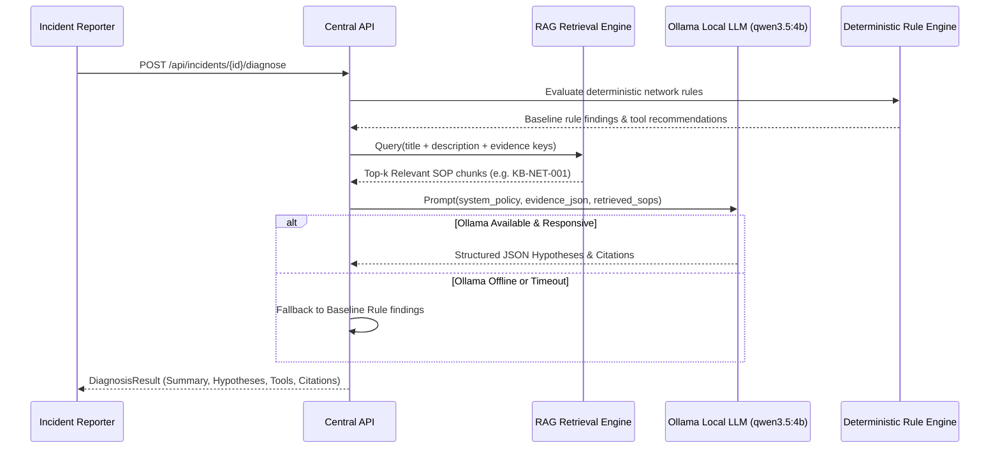

# AISD — AI & RAG Engineering Design

## 1. Principles of AI Diagnosis

1. **Separation of Observed Facts from Inferred Causes:**
   Diagnostic evidence represents raw facts (e.g. `ipv4_address = 169.254.88.192`, `gateway_ping = 100% loss`). The AI generates root-cause hypotheses based strictly on these facts.
2. **Advisory Role:**
   The AI never executes shell commands or alters database authorization tables directly. It returns structured Pydantic-validated JSON recommendations.
3. **Prompt Injection Defense:**
   Incident descriptions and retrieved troubleshooting documents are injected strictly as **data** inside JSON schemas, not instructions. Fixed system instructions prevent user text from overriding safety policies.
4. **Resilient Fallback:**
   If Ollama is unreachable, times out, or returns invalid syntax, the central server automatically falls back to deterministic diagnostic rules without interrupting ticket creation or technician workflows.

---

## 2. Structured AI Diagnosis Contract

The LLM is prompted to return valid JSON matching this schema:

```json
{
  "status": "hypotheses",
  "summary": "Network adapter has self-assigned an APIPA IP address with no default gateway. The device failed to acquire a DHCP lease.",
  "hypotheses": [
    {
      "cause": "DHCP lease acquisition failure (APIPA 169.254.x.x assigned)",
      "confidence": 0.95,
      "evidence_ids": ["ip_config"],
      "missing_evidence": ["dhcp_server_ack"],
      "next_checks": ["renew_dhcp", "test_gateway"]
    }
  ],
  "recommended_tool_ids": ["renew_dhcp"],
  "requires_technician": false,
  "sources": ["KB-NET-001"]
}
```

---

## 3. RAG Pipeline Architecture



---

## 4. Grounding & Citations

The RAG engine indexes approved Standard Operating Procedures (SOPs):
- `KB-NET-001`: College Wi-Fi & DHCP Lease Failure Recovery SOP
- `KB-NET-002`: Default Gateway Unreachable Troubleshooting Guide
- `KB-NET-003`: Campus DNS Resolution Failure Remediation
- `KB-NET-004`: Network Adapter Disabled or Disconnected SOP
- `KB-NET-005`: Campus Wi-Fi Captive Portal Authentication
- `KB-PRT-001`: Windows Print Spooler Service Stoppage Recovery SOP

Retrieved document identifiers are cited by the LLM and stored in the database for technician auditability.
