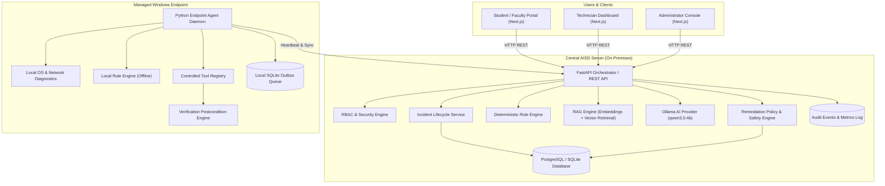
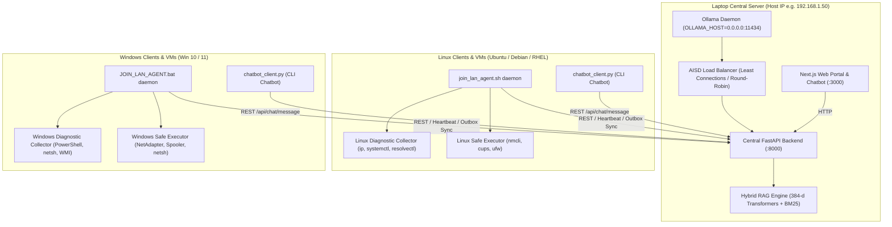

# AISD — System Architecture

## 1. Executive Overview

AISD is a college-focused, AI-assisted IT Incident Management System combining a centralized coordination and AI server with lightweight Windows endpoint agents.

Unlike traditional ticketing portals that merely log and route issues, AISD implements an evidence-driven diagnosis and policy-controlled remediation pipeline:
1. Incident submission (via portal or endpoint agent)
2. Telemetry & evidence collection
3. Deterministic rule evaluation
4. RAG troubleshooting SOP retrieval
5. Local Ollama LLM hypothesis generation
6. Remediation policy validation & approval gating
7. Predefined tool execution (Mock or Real)
8. Postcondition verification
9. Incident resolution upon verified proof

---

## 2. Component Topology

---

## 3. Online vs. Offline Operation

| Feature | Online Mode (Connected to Server) | Offline Mode (Endpoint Disconnected) |
|---|---|---|
| Incident Creation | Central database persistence | Local SQLite outbox queue |
| Diagnostics | Endpoint collects & uploads evidence | Local cross-platform endpoint collection |
| Diagnostic Reasoning | Rule Engine + Ollama LLM + RAG + Load Balancer | Local Deterministic Rules only |
| Troubleshooting SOPs | Central RAG hybrid (Transformers + BM25) | Local cached SOPs (Windows & Linux) |
| Remediation Execution | Predefined tools under central policy | Permitted local registered tools (Cross-Platform) |
| Verification | Central & agent postcondition verification | Local cross-platform postcondition verification |
| Synchronization | Real-time REST endpoints | Queued in SQLite; synced on reconnect |
| IT Chatbot | Interactive central chatbot with RAG & LLM | Standalone local chatbot with deterministic SOP advice |

---

## 4. Laptop Host Server & VM Client Architecture

### Key Subsystems:
1. **Ollama Server (Laptop Host)**:
   - Configured with `OLLAMA_HOST=0.0.0.0:11434` and `OLLAMA_ORIGINS=*` to serve VM clients over bridged or NAT/host-only networking.
2. **Ollama Load Balancer**:
   - Routes LLM inference across single or multiple Ollama nodes with automatic health check, active connection metrics, and failover.
3. **Cross-Platform Diagnostic & Remediation Engine**:
   - Seamlessly executes on Linux (using `ip`, `systemctl`, `resolvectl`, `nmcli`) and Windows (using PowerShell, `netsh`, `Get-Service`).
4. **Hybrid RAG System**:
   - Blends 384-dimensional dense semantic transformer vectors with sparse BM25 lexical token matching to retrieve both Windows and Linux IT procedures.
5. **Interactive IT Chatbot**:
   - Available via Web Portal (`/chat`) and as an interactive cross-platform CLI tool (`chatbot_client.py`) with automatic offline/online switching.

