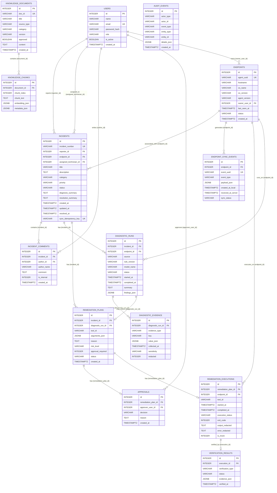

# AISD Database Entity-Relationship (ER) Documentation

This document provides the authoritative Entity-Relationship (ER) specification for the **AI-based Incident Support and Diagnosis (AISD)** platform. The production target database is **PostgreSQL 16+**.

---

## 1. Database Overview

The AISD database is structured around incident lifecycle management, endpoint agent synchronization, automated rule/AI diagnosis, policy-controlled remediation, postcondition verification, and auditability.

### Primary Operational Tenets
1. **Offline-First Synchronization**: Endpoint agents operate autonomously offline, storing events in local SQLite outboxes, and synchronize idempotently to PostgreSQL via `ENDPOINT_SYNC_EVENTS` deduplicated by `event_uuid`.
2. **Deterministic & Controlled Remediation**: Remediation plans are strictly governed by risk-levels and allowlist policies. Unapproved or arbitrary commands are prohibited.
3. **Mandatory Postcondition Verification**: Executing a remediation command does not guarantee incident resolution. A dedicated `VERIFICATION_RESULTS` record proves whether the issue is resolved via fresh diagnostic telemetry.

---

## 2. Implemented Entities & Descriptions

The schema consists of 14 core entities implemented in SQLAlchemy:

| Entity | Table Name | Description | Key Attributes |
|:---|:---|:---|:---|
| **Users** | `users` | System actors: students, faculty, technicians, and administrators. | `id` (PK), `name`, `email` (UK), `password_hash`, `role`, `is_active`, `created_at` |
| **Endpoints** | `endpoints` | Managed devices running the AISD endpoint agent. | `id` (PK), `agent_uuid` (UK), `hostname`, `os_name`, `os_version`, `agent_version`, `owner_user_id` (FK), `last_seen_at`, `status`, `created_at` |
| **Incidents** | `incidents` | Core incident ticket record. | `id` (PK), `incident_number` (UK), `reporter_id` (FK), `endpoint_id` (FK), `assigned_technician_id` (FK), `title`, `description`, `category`, `priority`, `status`, `diagnosis_summary`, `resolution_summary`, `created_at`, `updated_at`, `resolved_at`, `sync_idempotency_key` (UK) |
| **Incident Comments** | `incident_comments` | Timeline comments and progress notes on incidents. | `id` (PK), `incident_id` (FK), `author_id` (FK), `author_name`, `comment`, `is_internal`, `created_at` |
| **Diagnostic Runs** | `diagnostic_runs` | Diagnostic execution runs (Deterministic Rule, AI, or Technician). | `id` (PK), `incident_id` (FK), `endpoint_id` (FK), `source`, `rule_version`, `model_name`, `status`, `started_at`, `completed_at`, `summary`, `findings_json` |
| **Diagnostic Evidence** | `diagnostic_evidence` | Raw and structured telemetry gathered during a diagnostic run. | `id` (PK), `diagnostic_run_id` (FK), `evidence_type`, `key`, `value_json`, `collected_at`, `sensitivity`, `redacted` |
| **Knowledge Documents** | `knowledge_documents` | Standard Operating Procedures (SOPs), runbooks, and KB articles. | `id` (PK), `doc_id` (UK), `title`, `source_type`, `category`, `version`, `approved`, `content`, `created_at` |
| **Knowledge Chunks** | `knowledge_chunks` | Chunked text segments with embeddings for similarity search. | `id` (PK), `document_id` (FK), `chunk_index`, `chunk_text`, `embedding_json`, `metadata_json` |
| **Remediation Plans** | `remediation_plans` | Proposed allowlisted remediation actions. | `id` (PK), `incident_id` (FK), `diagnostic_run_id` (FK), `tool_id`, `arguments_json`, `reason`, `risk_level`, `approval_required`, `status`, `created_at` |
| **Approvals** | `approvals` | Authorization decisions recorded by technicians for R2/R3 actions. | `id` (PK), `remediation_plan_id` (FK, UK), `approver_user_id` (FK), `decision`, `reason`, `created_at` |
| **Remediation Executions** | `remediation_executions` | Execution audit records for approved remediation plans. | `id` (PK), `remediation_plan_id` (FK, UK), `endpoint_id` (FK), `tool_id`, `started_at`, `completed_at`, `execution_status`, `exit_code`, `output_redacted`, `error_redacted`, `is_mock` |
| **Verification Results** | `verification_results` | Automated postcondition checks proving issue resolution. | `id` (PK), `execution_id` (FK, UK), `verification_type`, `status`, `evidence_json`, `verified_at` |
| **Endpoint Sync Events** | `endpoint_sync_events` | Ingested events synchronized from offline endpoint agent outboxes. | `id` (PK), `endpoint_id` (FK), `event_uuid` (UK), `event_type`, `payload_json`, `created_at_local`, `received_at_server`, `sync_status` |
| **Audit Events** | `audit_events` | Immutable platform audit log of operations and state changes. | `id` (PK), `actor_type`, `actor_id`, `event_type`, `entity_type`, `entity_id`, `details_json`, `created_at` |

---

## 3. Relationship Descriptions

```
USERS
 ├── reports ───────────────< INCIDENTS (reporter_id -> users.id)
 ├── assigned_to ───────────< INCIDENTS (assigned_technician_id -> users.id)
 ├── writes ────────────────< INCIDENT_COMMENTS (author_id -> users.id)
 ├── approves ──────────────< APPROVALS (approver_user_id -> users.id)
 └── owns ──────────────────< ENDPOINTS (owner_user_id -> users.id)

ENDPOINTS
 ├── associated_with ───────< INCIDENTS (endpoint_id -> endpoints.id)
 ├── generates ─────────────< ENDPOINT_SYNC_EVENTS (endpoint_id -> endpoints.id)
 ├── executes_on ───────────< REMEDIATION_EXECUTIONS (endpoint_id -> endpoints.id)
 └── runs_on ───────────────< DIAGNOSTIC_RUNS (endpoint_id -> endpoints.id)

INCIDENTS
 ├── contains ──────────────< INCIDENT_COMMENTS (incident_id -> incidents.id)
 ├── has ───────────────────< DIAGNOSTIC_RUNS (incident_id -> incidents.id)
 └── has ───────────────────< REMEDIATION_PLANS (incident_id -> incidents.id)

DIAGNOSTIC_RUNS
 ├── contains ──────────────< DIAGNOSTIC_EVIDENCE (diagnostic_run_id -> diagnostic_runs.id)
 └── may inform ────────────< REMEDIATION_PLANS (diagnostic_run_id -> diagnostic_runs.id)

KNOWLEDGE_DOCUMENTS
 └── contains ──────────────< KNOWLEDGE_CHUNKS (document_id -> knowledge_documents.id)

REMEDIATION_PLANS
 ├── has ───────────────────  APPROVALS (remediation_plan_id -> remediation_plans.id) [1-to-1]
 └── has ───────────────────  REMEDIATION_EXECUTIONS (remediation_plan_id -> remediation_plans.id) [1-to-1]

REMEDIATION_EXECUTIONS
 └── verified_by ───────────  VERIFICATION_RESULTS (execution_id -> remediation_executions.id) [1-to-1]
```

---

## 4. Black-and-White Structural Diagram (Report & Presentation Format)

```
+-----------------------------------------------------------------------------------------------+
|                                  AISD DATABASE ENTITIES                                       |
+-----------------------------------------------------------------------------------------------+

  +-----------------------+                    +------------------------------------+
  |         USERS         | 1                * |             INCIDENTS              |
  |-----------------------|-------------------<|------------------------------------|
  | PK  id                | (reporter)         | PK  id                             |
  | UK  email             |                    | UK  incident_number                |
  |     name              | 1                * | FK  reporter_id                   |
  |     password_hash     |-------------------<| FK  endpoint_id                   |
  |     role              | (assigned)         | FK  assigned_technician_id         |
  |     is_active         |                    |     title, description, category   |
  |     created_at        |                    |     priority, status               |
  +-----------------------+                    |     diagnosis_summary              |
     | 1                | 1                    |     resolution_summary             |
     |                  |                      | UK  sync_idempotency_key           |
     |                  |                      |     created_at, updated_at         |
     | (writes)         | (approves)           +------------------------------------+
     |                  |                               | 1              | 1
     | *                | 1                             |                |
  +--------------------+|                               | *              | *
  | INCIDENT_COMMENTS  ||                        +---------------+ +-------------------+
  |--------------------||                        |DIAGNOSTIC_RUNS| | REMEDIATION_PLANS |
  | PK  id             ||                        |---------------| |-------------------|
  | FK  incident_id   -++                        | PK  id        | | PK  id            |
  | FK  author_id      |                         | FK  incident_id | FK  incident_id   |
  |     author_name    |                         | FK  endpoint_id | FK  diag_run_id   |
  |     comment        |                         |     source    | |     tool_id       |
  |     is_internal    |                         |     status    | |     risk_level    |
  |     created_at     |                         |     summary   | |     approval_req  |
  +--------------------+                         +---------------+ |     status        |
                                                         | 1       +-------------------+
  +-----------------------+                              |           | 1           | 1
  |       ENDPOINTS       |                              | *         | 1           | 1
  |-----------------------|                              |       +---------+   +---------------+
  | PK  id                |                      +-------------+ |APPROVALS|   |REMEDIATION_   |
  | UK  agent_uuid        |                      | DIAGNOSTIC_ | |---------|   |  EXECUTIONS   |
  |     hostname          |                      |  EVIDENCE   | | PK id   |   |---------------|
  |     os_name           |                      |-------------| | FK plan |   | PK  id        |
  |     status            |                      | PK id       | | FK user |   | FK  plan_id   |
  |     last_seen_at      |                      | FK run_id   | |  decision   | FK  endpoint  |
  +-----------------------+                      |    type, key| +---------+   |     tool_id   |
     | 1            | 1                          |    val_json |               |     status    |
     |              |                            +-------------+               +---------------+
     | *            | *                                                                | 1
  +---------------+ +--------------------+                                             | 1
  | ENDPOINT_SYNC | |    KNOWLEDGE_      |                                     +---------------+
  |    EVENTS     | |     DOCUMENTS      | 1                                 * | VERIFICATION_ |
  |---------------| |--------------------|------------------------------------<|    RESULTS    |
  | PK  id        | | PK  id             |                                     |---------------|
  | FK  endpoint  | | UK  doc_id         |                                     | PK  id        |
  | UK  event_uuid| |     title, content |                                     | FK  execution |
  |     event_type| +--------------------+                                     |     status    |
  |     payload   |           | 1                                              |     evidence  |
  |     status    |           | *                                              +---------------+
  +---------------+     +----------------+
                        |KNOWLEDGE_CHUNKS|
                        |----------------|
  +---------------+     | PK  id         |
  | AUDIT_EVENTS  |     | FK  doc_id     |
  |---------------|     |     chunk_text |
  | PK id         |     |     embedding  |
  |    actor_type |     +----------------+
  |    event_type |
  +---------------+
```

---

## 5. Mermaid ER Diagram Source


