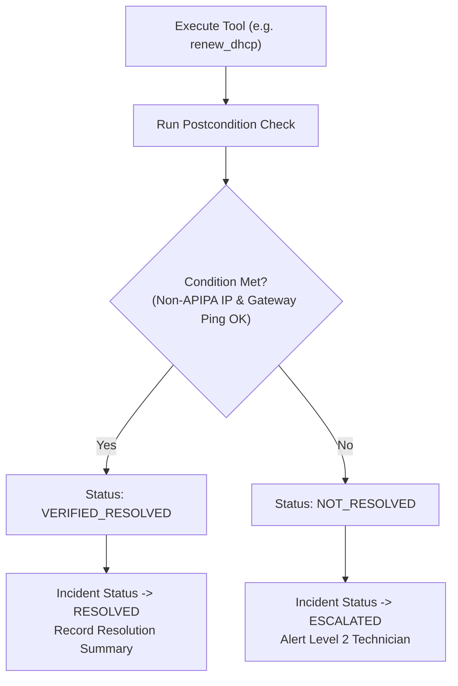

# AISD — Safety, Policy Engine & Remediation Model

## 1. Safety Rules & Boundaries

1. **No Arbitrary Shell Execution:**
   The AI is mathematically prevented from executing raw shell strings. The backend and endpoint agent only invoke tools registered in the `TOOL_REGISTRY`.
2. **Schema Validation:**
   Tool parameters are strictly checked against JSON schemas and enums before planning or execution.
3. **Risk Gating (R0 – R3):**
   - **R0 (Read-Only):** Telemetry collection (`collect_network_status`, `get_service_status`). Pre-approved under policy.
   - **R1 (Low Impact):** Diagnostics (`test_gateway`, `test_dns`, `flush_dns_cache`).
   - **R2 (Disruptive / Reversible):** Re-negotiating network lease or restarting services (`renew_dhcp`, `restart_approved_service`). Requires technician authorization.
   - **R3 (High Risk):** Kernel, driver, or registry changes. Blocked from automatic execution.
4. **Mock Execution by Default:**
   All execution recipes support mock simulation to guarantee lab/test safety. Real execution requires explicit configuration and administrator privilege.
5. **Mandatory Postcondition Verification:**
   An incident status CANNOT transition to `RESOLVED` unless verification returns `VERIFIED_RESOLVED`. If postcondition checks fail, the incident automatically transitions to `ESCALATED`.

---

## 2. Tool Registry Specification

| Tool ID | Name | Risk | Verification Type | Allowed Roles |
|---|---|---|---|---|
| `collect_network_status` | Inspect network adapters & IP | R0 | none | All |
| `test_gateway` | ICMP Ping to Default Gateway | R1 | `gateway_ping` | All |
| `test_dns` | Query campus & external DNS | R1 | `dns_resolve` | All |
| `renew_dhcp` | ipconfig /release && /renew | R2 | `ip_validity` | Tech, Admin |
| `flush_dns_cache` | Clear-DnsClientCache | R1 | `dns_resolve` | All |
| `restart_approved_service`| Restart Spooler or Dhcp service | R2 | `service_running` | Tech, Admin |
| `verify_network_connectivity`| Full end-to-end check | R0 | `full_network` | All |

---

## 3. Verification Postcondition Logic

